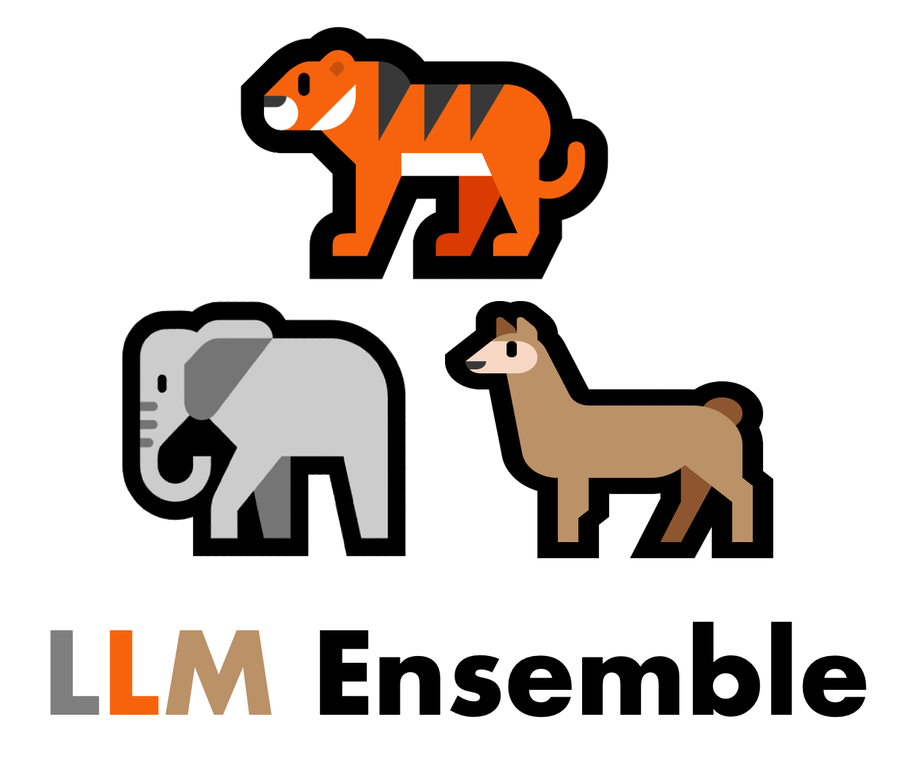
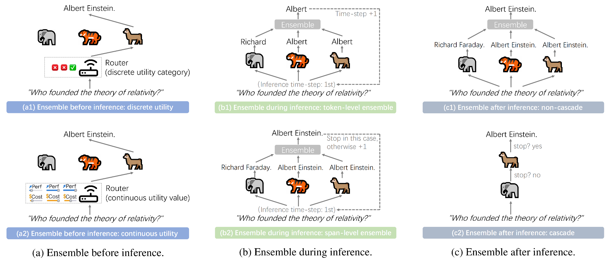
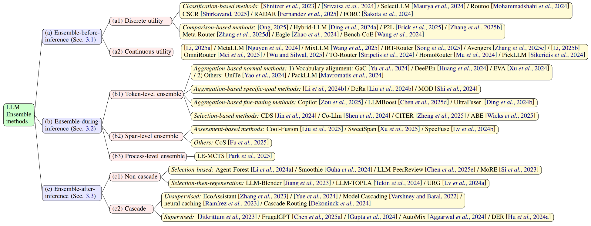
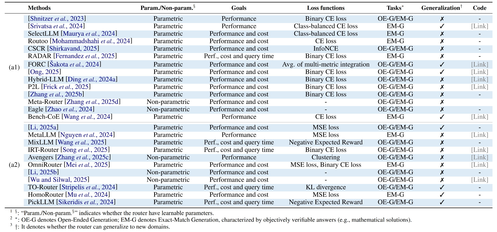
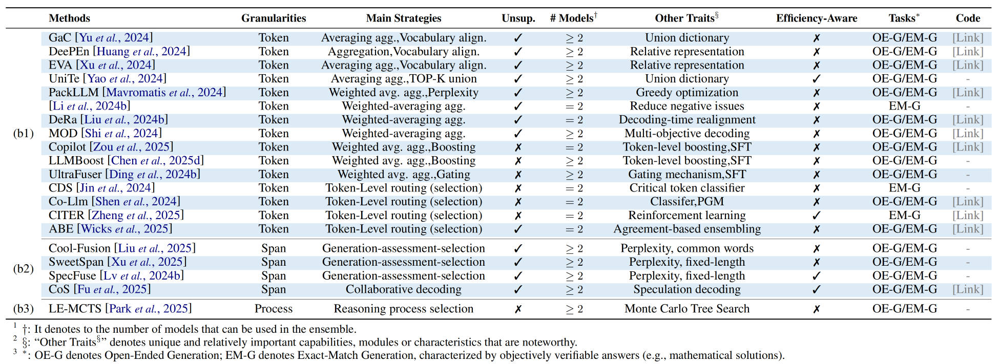
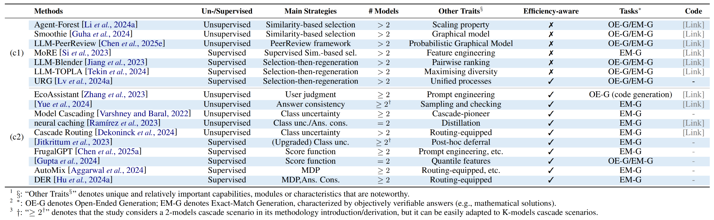
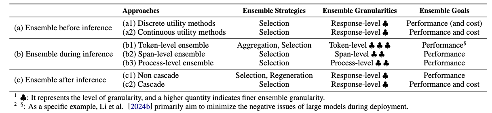

<h1 align="center">🔥🔥🔥 Awesome-LLM-Ensemble

"Harnessing Multiple Large Language Models: A Survey on LLM Ensemble" (IJCAI Survey 2026) </h2>

<p align="center">
    <a href="https://zhijunchen-ai.github.io/">Zhijun Chen</a>,
   <a href="https://scholar.google.com/citations?user=JEdD0o8AAAAJ&hl">Xiaodong Lu</a>,
    <a href="https://scholar.google.com/citations?user=6v6JfdsAAAAJ&hl=zh-en">Jingzheng Li</a>,
    <a href="https://scholar.google.com/citations?user=mzXg1s8AAAAJ&hl=zh-en">Pengpeng Chen</a>,
    <a href="https://lizhuoran-nlp.github.io/">Zhuoran Li</a>,
    <a href="https://scholar.google.com/citations?user=buUlnJUAAAAJ&hl=zh-en">Kai Sun</a>,
    <a href="https://luoyk1999.github.io/">Yuankai Luo</a>,
    <a href="https://scholar.google.com/citations?hl=zh-CN&user=PnDqlPkAAAAJ&view_op=list_works&sortby=pubdate">Qianren Mao</a>,
    <a href="https://scholar.google.com/citations?user=H3pKglUAAAAJ&hl=zh-en">Ming Li</a>,    
    <a href="https://www.researchgate.net/scientific-contributions/Likang-Xiao-2257895822">Likang Xiao</a>,
    <a href="https://scholar.google.co.uk/citations?user=fnfg9S0AAAAJ&hl=en">Dingqi Yang</a>,
    <a href="https://scholar.google.com/citations?user=Be21PkYAAAAJ">Xiao Huang</a>,
    <a href="https://www.banyikun.com/">Yikun Ban</a>,
    <a href="https://scholar.google.com/citations?user=HWOWCdcAAAAJ&hl=zh-CN">Hailong Sun</a>,
    <a href="https://scholar.google.com/citations?user=D0lL1r0AAAAJ&hl=zh-CN/">Philip S. Yu</a>
</p>
<p align="center">
    
</p>


<p align="center">
  <a href='https://arxiv.org/abs/2502.18036'></a>
  <a href="https://junchenzhi.github.io/LLM-Ensemble/">
    
  </a>
  <a href="https://mp.weixin.qq.com/s/yVWzHQmr_KyyOfY5k3ivOw">
    
  </a>
</p>


<p align="center">
      <a href="https://github.com/junchenzhi/Awesome-LLM-Ensemble/commits/main">
        
      </a>
      <a href="https://github.com/junchenzhi/Awesome-LLM-Ensemble/blob/main/LICENSE">
        
      </a>
      <a href="https://awesome.re">
        
      </a>
  <a href="https://img.shields.io/badge/PRs-Welcome-red">
    
  </a>
  <a href=""></a>

</p>


<p align="center">
  <a href="https://github.com/junchenzhi/Awesome-LLM-Ensemble/stargazers">
    
  </a>
  <a href="https://github.com/junchenzhi/Awesome-LLM-Ensemble/network">
    
  </a>
  <!-- GS_CITATIONS_BADGE_START -->
<a href="https://scholar.google.com/citations?view_op=view_citation&hl=en&user=3slpkWAAAAAJ&pagesize=100&citation_for_view=3slpkWAAAAAJ:_kc_bZDykSQC">
  
</a>
<!-- GS_CITATIONS_BADGE_END -->
</p>


<h5 align="center">If you like our project, please give it a star ⭐ to show your support！Thank you:)

</h5>


# 📣 Notices
> 🔥🔥🔥 This is a collection of papers on  ***LLM Ensemble***.  
> <a href='https://arxiv.org/abs/2502.18036'>
>   
> </a>
> <a href="https://junchenzhi.github.io/LLM-Ensemble/">
>   
> </a>
> <a href="https://mp.weixin.qq.com/s/yVWzHQmr_KyyOfY5k3ivOw">
>   
> </a>

> **[2026-05] Accepted by IJCAI Survey 2026!**    
>

> 🔥🔥🔥 **[2026-04] We have updated our arXiv paper with a new version! Stay tuned for our journal-style paper in recent months.**    
>


> **[Always] [Add your papers in this repo]** **Thank you to all the papers that have cited our survey.**      
>We will add all related citing papers to this GitHub repo, in a timely manner, to help increase the visibility of your contributions.    


> **[Always] [Maintain]** **We will make this list updated frequently!**     
> If you found any missed/new paper, please don't hesitate to contact [us](zhijunchen@buaa.edu.cn) or Pull requests. 


&nbsp; 

## 🍀 Citation
If you find this survey useful, please consider citing our paper:


```
@article{chen2025harnessing,
  title={Harnessing Multiple Large Language Models: A Survey on LLM Ensemble},
  author={Chen, Zhijun and Lu, Xiaodong and Li, Jingzheng and Chen, Pengpeng and Li, Zhuoran and Sun, Kai and Luo, Yuankai and Mao, Qianren and Li, Ming and Xiao, Likang and Yang, Dingqi and Huang, Xiao and Ban, Yikun and Sun, Hailong and Yu, Philip S},
  journal={arXiv preprint arXiv:2502.18036},
  year={2025}
}
```

&nbsp; 
&nbsp;  
&nbsp; 


- [Contents](#Awesome-LLM-Ensemble)
  - [1. LLM Ensemble and Taxonomy](#1-llm-ensemble-and-taxonomy)
    - [1.1 LLM Ensemble](#11-llm-ensemble)
    - [1.2 Taxonomy](#12-taxonomy)
  - [2. Papers](#2-papers)
    - [2.1 Ensemble Before Inference](#21-ensemble-before-inference)
      - [2.1.1 (a,1) Pre-Trained Router](#211-a1-pre-trained-router)
      - [2.1.2 (a,2) Non pre-trained router](#212-a2-non-pre-trained-router)
    - [2.2 Ensemble During Inference](#22-ensemble-during-inference)
      - [2.2.1 (b,1) Token-Level Ensemble](#221-b1-token-level-ensemble)
      - [2.2.2 (b,2) Span-Level Ensemble](#222-b2-span-level-ensemble)
      - [2.2.3 (b,3) Process-Level Ensemble](#223-b3-process-level-ensemble)
    - [2.3 Ensemble After Inference](#23-ensemble-after-inference)
      - [2.3.1 (c,1) Non Cascade](#231-c1-non-cascade)
      - [2.3.2 (c,2) Cascade](#232-c2-cascade)
    - [2.4 Others: Benchmarks, Applications, Systems and Related Surveys](#24-others-benchmarks-applications-systems-and-related-surveys)
      - [2.4.1 Benchmarks](#241-benchmarks)
      - [2.4.2 Applications](#242-applications)
      - [2.4.3 Systems](#243-systems)
      - [2.4.4 Related Surveys](#244-related-surveys)
  - [3 Others: Some public implementations of the LLM Ensemble methods](#3-others-some-public-implementations-of-the-llm-ensemble-methods)
  - [4 Others: Some other related interesting papers](#4-others-some-other-related-interesting-papers)
      - [4.1 Test-Time Scaling](#41-test-time-scaling)
      - [4.2 LLM Collaboration and Others](#42-llm-collaboration-and-others)
      - [4.3 Ensemble (or Routing) Methods for Long-Horizon Agent Tasks](#43-ensemble-or-routing-methods-for-long-horizon-agent-tasks)
  - [5 Summarization](#5-summarization)


# 1. LLM Ensemble and Taxonomy

## 1.1 LLM Ensemble
**Paper Abstract**:

LLM Ensemble---which involves the comprehensive use of multiple large language models (LLMs), each aimed at handling user queries during the downstream inference, to benefit from their individual strengths---has gained substantial attention recently. 
The widespread availability of LLMs, coupled with their varying strengths and out-of-the-box usability, has profoundly advanced the field of LLM Ensemble. 
This paper presents the first systematic review of recent developments in LLM Ensemble. 
First, we introduce our taxonomy of LLM Ensemble and discuss several related research problems. 
Then, we provide a more in-depth classification of methods under the broad categories of ``ensemble-before-inference, ensemble-during-inference, ensemble-after-inference'', and review all relevant methods. Finally, we introduce related benchmarks and applications, summarize existing studies, and suggest several future research directions. 
A curated list of papers  on LLM Ensemble is available at https://github.com/junchenzhi/Awesome-LLM-Ensemble.

## 1.2 Taxonomy

<div align=center>


**Figure 1:  Illustration of LLM Ensemble Taxonomy.** (Note that for *(b) ensemble-during-inference* paradigm, there is also a *process-level ensemble* approach that we have not represented in the figure, mainly because that this approach is instantiated by a single method.)
</div>


<div align=center>


**Figure 2: Taxonomy of All LLM Ensemble Methods. (Please note that this figure may not be fully updated to include all the papers listed below.)**
</div>


- ***(a) Ensemble before inference.***  
Since the ensemble-before-inference methods require routing a query to the most suitable LLM before LLM inference, the core of such methods lies in predicting the utility of candidate models for a given query under certain preferences (e.g., performance or cost). Based on how they formulate the utility of candidate LLMs, we divide existing methods into two categories:
  - ***(a1) Discrete utility*** methods, discretize the model utility into categorical labels;
  - ***(a2) Continuous utility*** methods model LLM utility as real-valued variables, such as response length or performance scores. This formulation enables a fine-grained characterization of model behavior, capturing subtle performance differences obscured by categorical definitions.


- ***(b) Ensemble during inference.***  
As the most granular form of ensemble among the three broad categories, this type of approach encompasses: 
  - ***(b1) Token-level ensemble*** methods, which integrate the token-level outputs of multiple models at the finest granularity of decoding;
  - ***(b2) Span-level ensemble*** methods, which conduct ensemble at the level of a sequence fragment (e.g., a span of four words); 
  - ***(b3) Process-level ensemble*** methods, which select the optimal reasoning process step-by-step within the reasoning chain for a given complex reasoning task. 
Note that for these ensemble-during-inference methods, the aggregated text segments will be concatenated with the previous text and fed again to models.


- ***(c) Ensemble after inference.***  
These methods can be classified into two categories:
  - ***(c1) Non cascade*** methods, which perform ensemble using multiple complete responses contributed from all LLM candidates;
  - ***(c2) Cascade*** methods, which consider both performance and inference costs, progressively reasoning through a chain of LLM candidates largely sorted by model size to find the most suitable inference response.


&nbsp; 
&nbsp;  
&nbsp; 


# 2. Papers

## 2.1 Ensemble Before Inference


<div align=center>


Figure 3:  Summary analysis of the key attributes of ensemble-before-inference methods.  (Please note that this table may not be fully updated to include all the papers listed below.)
</div>


### 2.1.1 (a,1) Discrete utility methods


- MARS: Memory-Aware Routing for Session-Level LLM Assistants  
  2026-10 · `MARS` · <a href="https://arxiv.org/abs/2610.23583"></a>

- Alliance of Stochastic Routing and Reinforcement Fusion for Multi-Model Reasoning  
  2026-10 · `VL-Scout` · <a href="https://arxiv.org/abs/2610.24054"></a>

- RouteWeaver: Weaving Mode Selection and Execution into Unified LLM Routing  
  2026-10 · `RouteWeaver` · <a href="https://arxiv.org/abs/2610.19705"></a>

- CopRoute: Dependence-Aware Conformal Routing for Language Models  
  2026-10 · `CopRoute` · <a href="https://arxiv.org/abs/2610.13276"></a>&ensp;[](https://github.com/kasakh/coproute)

- Prompt-Only LLM Routing with Conformal Regret Control  
  2026-10 · <a href="https://doi.org/10.1007/978-3-032-39895-6_26"></a>

- Pretrain Once, Route Anywhere: Towards a Foundation Model for LLM Routing  
  2026-09 · `RouteFM` · <a href="https://arxiv.org/abs/2609.37362"></a>&ensp;[](https://github.com/LAMDA-Model-Reuse/RouteFM)

- Agent-as-a-Router: Agentic Model Routing for Coding Tasks  
  2026-06 · `ACRouter` · <a href="https://arxiv.org/abs/2606.22902"></a>&ensp;[](https://github.com/LanceZPF/agent-as-a-router)

- From Myopic Selection to Long-Horizon Awareness: Sequential LLM Routing for Multi-Turn Dialogue  
  2026-04 · `DialRouter` · <a href="https://arxiv.org/abs/2604.12385"></a>

- DISROUTER: Distributed Self-Routing for LLM Selections  
  2025-10 · `DiSRouter` · <a href="https://arxiv.org/abs/2510.19208"></a>

- TAGROUTER: Learning Route to LLMs through Tags for Open-Domain Text Generation Tasks  
  2025-06 · `TagRouter` · <a href="https://arxiv.org/abs/2506.12473"></a>

- Router-R1: Teaching LLMs Multi-Round Routing and Aggregation via Reinforcement Learning  
  2025-06 · `Router-R1` · <a href="https://arxiv.org/abs/2506.09033"></a>&ensp;[](https://github.com/ulab-uiuc/Router-R1)

- RadialRouter: Structured Representation for Efficient and Robust Large Language Models Routing  
  2025-06 · `RadialRouter` · <a href="https://www.arxiv.org/abs/2506.03880"></a>

- Route to Reason: Adaptive Routing for LLM and Reasoning Strategy Selection  
  2025-05 · `RTR` · <a href="https://arxiv.org/abs/2505.19435"></a>&ensp;[](https://github.com/goodmanpzh/Route-To-Reason)

- Bench-CoE: a Framework for Collaboration of Experts from Benchmark  
  2024-12 · `Bench-CoE` · <a href="https://arxiv.org/abs/2412.04167"></a>&ensp;[](https://github.com/ZhangXJ199/Bench-CoE)

- GraphRouter: A Graph-based Router for LLM Selections  
  2024-10 · `GraphRouter` · <a href="https://arxiv.org/abs/2410.03834"></a>&ensp;[](https://github.com/ulab-uiuc/GraphRouter)

- Eagle: Efficient Training-Free Router for Multi-LLM Inference  
  2024-09 · `Eagle` · <a href="https://arxiv.org/abs/2409.15518"></a>

- SelectLLM: Query-Aware Efficient Selection Algorithm for Large Language Models  
  2024-08 · `SelectLLM` · <a href="https://arxiv.org/abs/2408.08545"></a>

- RouteLLM: Learning to Route LLMs with Preference Data  
  2024-06 · `RouteLLM` · <a href="https://arxiv.org/abs/2406.18665"></a>&ensp;[](https://github.com/lm-sys/RouteLLM)

- Harnessing the Power of Multiple Minds: Lessons Learned from LLM Routing  
  2024-05 · `LLM Routing Lessons` · <a href="https://arxiv.org/abs/2405.00467"></a>&ensp;[](https://github.com/kvadityasrivatsa/llm-routing)

- Hybrid LLM: Cost-Efficient and Quality-Aware Query Routing  
  2024-04 · `Hybrid-LLM` · <a href="https://arxiv.org/abs/2404.14618"></a>

- An Expert is Worth One Token: Synergizing Multiple Expert LLMs as Generalist via Expert Token Routing  
  2024-03 · `ETR` · <a href="https://arxiv.org/abs/2403.16854"></a>&ensp;[](https://github.com/zjunet/ETR)

- Routoo: Learning to Route to Large Language Models Effectively  
  2024-01 · `Routoo` · <a href="https://arxiv.org/abs/2401.13979"></a>

- RouterDC: Query-Based Router by Dual Contrastive Learning for Assembling Large Language Models  
  2024 · `RouterDC` · <a href="https://proceedings.neurips.cc/paper_files/paper/2024/hash/7a641b8ec86162fc875fb9f6456a542f-Abstract-Conference.html"></a>&ensp;[](https://github.com/shuhao02/RouterDC)

- Routing to the Expert: Efficient Reward-guided Ensemble of Large Language Models  
  2023-11 · `ZOOTER` · <a href="https://arxiv.org/abs/2311.08692"></a>

- Fly-Swat or Cannon? Cost-Effective Language Model Choice via Meta-Modeling  
  2023-08 · `FORC` · <a href="https://arxiv.org/abs/2308.06077"></a>&ensp;[](https://github.com/epfl-dlab/forc)

- LLM Routing with Benchmark Datasets  
  2023 · `Benchmark Routing` · <a href="https://openreview.net/forum?id=k9EfAJhFZc"></a>


### 2.1.2 (a,2) Continuous utility methods

- Which Model for Which Role? Cost-Efficient Pareto Recommendation for LLM Agentic Workflows  
  2026-10 · `CC-Gittins` · <a href="https://arxiv.org/abs/2610.26676"></a>

- Breaking the Tie: A Cluster-Aware Routing Framework for Large Language Models  
  2026-10 · `CASLR` · <a href="https://arxiv.org/abs/2610.05982"></a>

- Which Models Work Well Together? Measuring Heterogeneity for LLM Team Selection  
  2026-09 · `C²-MAS` · <a href="https://arxiv.org/abs/2609.38274"></a>

- FLARE: Fine-Grained Length-Aware Routing for Resource-Efficient Heterogeneous LLM Serving  
  2026-06 · `FLARE` · <a href="https://aclanthology.org/2026.acl-long.1018/"></a>

- Conformal LLM Routing with Distribution-Free Safety Guarantees  
  2026-06 · <a href="https://aclanthology.org/2026.acl-srw.70/"></a>

- SCOPE: Cost-Efficient Model Selection for Compound AI Systems under Quality Constraints  
  2026-06 · `SCOPE` · <a href="https://arxiv.org/abs/2606.00774"></a>

- MonoRouter: Enforcing Monotonicity in Item Response Theory for LLM Routing  
  2026-03 · `MonoRouter` · <a href="https://www.semanticscholar.org/paper/4d269df75f97ae82ba63bd248e1d7d9adf30e0a0"></a>

- ReLope: KL-Regularized LoRA Probes for Multimodal LLM Routing  
  2026-03 · `ReLope` · <a href="https://arxiv.org/abs/2603.24787"></a>&ensp;[](https://github.com/Spinozaaa/ReLope)

- Multi-LLM Query Optimization  
  2026-03 · <a href="https://arxiv.org/abs/2603.24617"></a>

- RACER: Risk-Aware Calibrated Efficient Routing for Large Language Models  
  2026-02 · `RACER` · <a href="https://arxiv.org/abs/2603.06616"></a>

- Don't Always Pick the Highest-Performing Model: An Information Theoretic View of LLM Ensemble Selection  
  2026-02 · <a href="https://arxiv.org/abs/2602.08003"></a>

- EPIC: Ensemble Planning with Contrastive learning  
  2025-11 · `EPIC` · <a href="https://arxiv.org/abs/2511.00521"></a>&ensp;[](https://github.com/nguyenngocbaocmt02/EPIC)

- WebRouter: Query-specific Router via Variational Information Bottleneck for Cost-sensitive Web Agent  
  2025-10 · `WebRouter` · <a href="https://arxiv.org/abs/2510.11221"></a>

- LLMRank: Understanding LLM Strengths for Model Routing  
  2025-10 · `LLMRank` · <a href="https://arxiv.org/abs/2510.01234"></a>

- The Avengers: A Simple Recipe for Uniting Smaller Language Models to Challenge Proprietary Giants  
  2025-05 · `Avengers` · <a href="https://arxiv.org/abs/2505.19797"></a>&ensp;[](https://github.com/ZhangYiqun018/Avengers)

- InferenceDynamics: Efficient Routing Across LLMs through Structured Capability and Knowledge Profiling  
  2025-05 · `InferenceDynamics` · <a href="https://arxiv.org/abs/2505.16303"></a>

- Rethinking Predictive Modeling for LLM Routing: When Simple kNN Beats Complex Learned Routers  
  2025-05 · `kNN Router` · <a href="https://arxiv.org/abs/2505.12601"></a>

- Co-optimizing Recommendation and Evaluation for LLM Selection  
  2025 · `RELM` · <a href="https://openreview.net/pdf?id=gWi4ZcPQRl"></a>

- LLM Bandit: Cost-Efficient LLM Generation via Preference-Conditioned Dynamic Routing  
  2025-02 · `LLM Bandit` · <a href="https://arxiv.org/abs/2502.02743"></a>

- PickLLM: Context-Aware RL-Assisted Large Language Model Routing  
  2024-12 · `PickLLM` · <a href="https://arxiv.org/abs/2412.12170"></a>

- TensorOpera Router: A Multi-Model Router for Efficient LLM Inference  
  2024-08 · `TO-Router` · <a href="https://arxiv.org/abs/2408.12320"></a>

- MetaLLM: A High-performant and Cost-efficient Dynamic Framework for Wrapping LLMs  
  2024-07 · `MetaLLM` · <a href="https://arxiv.org/abs/2407.10834"></a>&ensp;[](https://github.com/mail-research/MetaLLM-wrapper/)

- Query Routing for Homogeneous Tools: An Instantiation in the RAG Scenario  
  2024-06 · `HomoRouter` · <a href="https://arxiv.org/abs/2406.12429"></a>

- Blending Is All You Need: Cheaper, Better Alternative to Trillion-Parameters LLM  
  2024-01 · `Blending` · <a href="https://arxiv.org/abs/2401.02994"></a>


## 2.2 Ensemble During Inference

<div align=center>


Figure 4:  Summary analysis of the key attributes of ensemble-during-inference methods.  (Please note that this table may not be fully updated to include all the papers listed below.)
</div>


### 2.2.1 (b,1) Token-Level Ensemble


- DLLG: Dynamic Logit-Level Gating of LLM Experts  
  2026-06 · `DLLG` · <a href="https://arxiv.org/abs/2606.04378"></a>

- Linear Ensembles Wash Away Watermarks: On the Fragility of Distributional Perturbations in LLMs  
  2026-05 · `WASH` · <a href="https://arxiv.org/abs/2605.30501"></a>

- Rethinking LLM Ensembling from the Perspective of Mixture Models  
  2026-05 · `ME` · <a href="https://arxiv.org/abs/2605.00419"></a>&ensp;[](https://github.com/Kamichanw/Mixture-model-like-Ensemble)

- SpecFed: Accelerating Federated LLM Inference with Speculative Decoding and Compressed Transmission  
  2026-04 · `SpecFed` · <a href="https://arxiv.org/abs/2604.25777"></a>

- Token-Level LLM Collaboration via FusionRoute  
  2026-01 · `FusionRoute` · <a href="https://arxiv.org/abs/2601.05106"></a>

- When to Ensemble: Identifying Token-Level Points for Stable and Fast LLM Ensembling  
  2025-10 · `SAFE` · <a href="https://arxiv.org/pdf/2510.15346"></a>

- Harnessing Consistency for Robust Test-Time LLM Ensemble  
  2025-10 · `CoRe` · <a href="https://www.arxiv.org/abs/2510.13855"></a>

- Transformer Copilot: Learning from The Mistake Log in LLM Fine-tuning  
  2025-05 · `Transformer Copilot` · <a href="https://arxiv.org/abs/2505.16270"></a>&ensp;[](https://github.com/jiaruzouu/TransformerCopilot)

- Token-level Ensembling of Models with Different Vocabularies  
  2025-02 · `ABE` · <a href="https://arxiv.org/abs/2502.21265"></a>&ensp;[](https://github.com/mjpost/abe)

- CITER: Collaborative Inference for Efficient Large Language Model Decoding with Token-Level Routing  
  2025-02 · `CITER` · <a href="https://arxiv.org/abs/2502.01976"></a>&ensp;[](https://github.com/aiming-lab/CITER)

- Determine-Then-Ensemble: Necessity of Top-k Union for Large Language Model Ensembling  
  2024-10 · `UniTe` · <a href="https://arxiv.org/abs/2410.03777"></a>

- Breaking the Ceiling of the LLM Community by Treating Token Generation as a Classification for Ensembling  
  2024-06 · `GaC` · <a href="https://arxiv.org/abs/2406.12585"></a>&ensp;[](https://github.com/yaoching0/GaC)

- Ensemble Learning for Heterogeneous Large Language Models with Deep Parallel Collaboration  
  2024-04 · `DeePEn` · <a href="https://arxiv.org/abs/2404.12715"></a>&ensp;[](https://github.com/OrangeInSouth/DeePEn)

- Pack of LLMs: Model Fusion at Test-Time via Perplexity Optimization  
  2024-04 · `PackLLM` · <a href="https://arxiv.org/abs/2404.11531"></a>&ensp;[](https://github.com/cmavro/PackLLM)

- Bridging the Gap between Different Vocabularies for LLM Ensemble  
  2024-04 · `EVA` · <a href="https://arxiv.org/abs/2404.09492"></a>&ensp;[](https://github.com/xydaytoy/EVA)

- Purifying large language models by ensembling a small language model  
  2024-02 · <a href="https://arxiv.org/abs/2402.14845"></a>


### 2.2.2 (b,2) Span-Level Ensemble

- AdaFuse: Adaptive Ensemble Decoding with Test-Time Scaling for LLMs  
  2026-01 · `AdaFuse` · <a href="https://arxiv.org/abs/2601.06022"></a>&ensp;[](https://github.com/CCM0111/AdaFuse)

- RLAE: Reinforcement Learning-Assisted Ensemble for LLMs  
  2025-06 · `RLAE` · <a href="https://arxiv.org/abs/2506.00439"></a>

- Speculative Ensemble: Fast Large Language Model Ensemble via Speculation  
  2025-02 · `Speculative Ensemble` · <a href="https://arxiv.org/abs/2502.01662"></a>&ensp;[](https://github.com/Kamichanw/Speculative-Ensemble/)

- SpecFuse: Ensembling Large Language Models via Next-Segment Prediction  
  2024-12 · `SpecFuse` · <a href="https://arxiv.org/abs/2412.07380"></a>

- Hit the Sweet Spot! Span-Level Ensemble for Large Language Models  
  2024-09 · `SweetSpan` · <a href="https://arxiv.org/abs/2409.18583"></a>

- Cool-Fusion: Fuse Large Language Models without Training  
  2024-07 · `Cool-Fusion` · <a href="https://arxiv.org/abs/2407.19807"></a>


### 2.2.3 (b,3) Process-Level Ensemble


- Empirical Study of Process Reward-Guided Model Ensemble for Edge Reasoning  
  2026-05 · <a href="https://www.semanticscholar.org/paper/cb402251297a6349231d9f48995c264c3117eb4a"></a>

- RouteGoT: Node-Adaptive Routing for Cost-Efficient Graph of Thoughts Reasoning  
  2026-03 · `RouteGoT` · <a href="https://arxiv.org/abs/2603.05818"></a>

- Collaborative Beam Search: Enhancing LLM Reasoning via Collective Consensus  
  2025-11 · `CBS` · <a href="https://aclanthology.org/2025.emnlp-main.574/"></a>

- Ensembling Large Language Models with Process Reward-Guided Tree Search for Better Complex Reasoning  
  2024-12 · `LE-MCTS` · <a href="https://arxiv.org/abs/2412.15797"></a>


&nbsp; 


## 2.3 Ensemble After Inference


<div align=center>


Figure 5:  Summary analysis of the key attributes of ensemble-after-inference methods.  (Please note that this table may not be fully updated to include all the papers listed below.)
</div>


### 2.3.1 (c,1) Non Cascade


- A Jury, Not an Electorate: Label-Free Reliability Estimation for Ensembles of Language Models  
  2026-10 · `Jury` · <a href="https://arxiv.org/abs/2610.21085"></a>&ensp;[](https://github.com/distributedcognition/jury)

- CUSP: Decomposable Collective Uncertainty for Multi-Agent Multimodal Reasoning  
  2026-09 · `CUSP` · <a href="https://arxiv.org/abs/2609.05708"></a>

- Mixture of Complementary Agents for Robust LLM Ensemble  
  2026-05 · `MCA` · <a href="https://arxiv.org/abs/2605.24048"></a>

- SCoOP: Semantic Consistent Opinion Pooling for Uncertainty Quantification in Multiple Vision-Language Model Systems  
  2026-03 · `SCoOP` · <a href="https://arxiv.org/abs/2603.23853"></a>&ensp;[](https://github.com/chungenyu6/SCoOP)

- Scoring, Reasoning, and Selecting the Best! Ensembling Large Language Models via a Peer-Review Process  
  2025-12 · `LLM-PeerReview` · <a href="https://arxiv.org/abs/2512.23213"></a>&ensp;[](https://github.com/zeyuji/LLM-PeerReview)

- LLMartini: Seamless and Interactive Leveraging of Multiple LLMs through Comparison and Composition  
  2025-10 · `LLMartini` · <a href="https://arxiv.org/abs/2510.19252"></a>

- Beyond Consensus: Mitigating the Agreeableness Bias in LLM Judge Evaluations  
  2025-10 · <a href="https://arxiv.org/abs/2510.11822"></a>&ensp;[](https://github.com/ai-cet/paper-arxiv-llm-judge-calibration)

- Beyond Majority Voting: LLM Aggregation by Leveraging Higher-Order Information  
  2025-10 · `OW/ISP` · <a href="https://www.arxiv.org/abs/2510.01499"></a>

- Explainable Fault Localization for Programming Assignments via LLM-Guided Annotation  
  2025-09 · `FLAME` · <a href="https://arxiv.org/pdf/2509.25676v1"></a>&ensp;[](https://github.com/FLAME-FL/FLAME)

- CARGO: A Framework for Confidence-Aware Routing of Large Language Models  
  2025-09 · `CARGO` · <a href="https://arxiv.org/abs/2509.14899"></a>

- LENS: Learning Ensemble Confidence from Neural States for Multi-LLM Answer Integration  
  2025-07 · `LENS` · <a href="https://arxiv.org/abs/2507.23167"></a>

- EL4NER: Ensemble Learning for Named Entity Recognition via Multiple Small-Parameter Large Language Models  
  2025-05 · `EL4NER` · <a href="https://arxiv.org/abs/2505.23038"></a>

- Weight Ensembling Improves Reasoning in Language Models  
  2025-04 · `WiSE-FT` · <a href="https://arxiv.org/abs/2504.10478"></a>

- Symbolic Mixture-of-Experts: Adaptive Skill-based Routing for Heterogeneous Reasoning  
  2025-03 · `Symbolic-MoE` · <a href="https://arxiv.org/abs/2503.05641"></a>&ensp;[](https://github.com/dinobby/Symbolic-MoE/)

- DFPE: A Diverse Fingerprint Ensemble for Enhancing LLM Performance  
  2025-01 · `DFPE` · <a href="https://arxiv.org/abs/2501.17479"></a>&ensp;[](https://github.com/nivgold/DFPE)

- Balancing Act: Diversity and Consistency in Large Language Model Ensembles  
  2025-01 · `DMoA` · <a href="https://openreview.net/pdf?id=Dl6nkKKvlX"></a>

- Smoothie: Label Free Language Model Routing  
  2024-12 · `Smoothie` · <a href="https://arxiv.org/abs/2412.04692"></a>&ensp;[](https://github.com/HazyResearch/smoothie)

- LLM-Forest: Ensemble Learning of LLMs with Graph-Augmented Prompts for Data Imputation  
  2024-10 · `LLM-Forest` · <a href="https://arxiv.org/abs/2410.21520"></a>&ensp;[](https://github.com/Xinrui17/LLM-Forest)

- LLM-TOPLA: Efficient LLM Ensemble by Maximising Diversity  
  2024-10 · `LLM-TOPLA` · <a href="https://arxiv.org/abs/2410.03953"></a>&ensp;[](https://github.com/git-disl/llm-topla)

- Two Heads are Better than One: Zero-shot Cognitive Reasoning via Multi-LLM Knowledge Fusion  
  2024-10 · `MLKF` · <a href="https://dl.acm.org/doi/abs/10.1145/3627673.3679744"></a>

- URG: A Unified Ranking and Generation Method for Ensembling Language Models  
  2024-08 · `URG` · <a href="https://aclanthology.org/2024.findings-acl.261/"></a>

- More Agents Is All You Need  
  2024-02 · `Agent-Forest` · <a href="https://arxiv.org/abs/2402.05120"></a>&ensp;[](https://github.com/MoreAgentsIsAllYouNeed/AgentForest)

- LLM-Blender: Ensembling Large Language Models with Pairwise Ranking and Generative Fusion  
  2023-06 · `LLM-Blender` · <a href="https://arxiv.org/abs/2306.02561"></a>&ensp;[](https://github.com/yuchenlin/LLM-Blender)

- Getting MoRE out of Mixture of Language Model Reasoning Experts  
  2023-05 · `MoRE` · <a href="https://arxiv.org/abs/2305.14628"></a>&ensp;[](https://github.com/NoviScl/MoRE)

### 2.3.2 (c,2) Cascade


- Who Pays for Efficient Inference? Confidence-Based Small-to-Large LLM Routing Across Tasks and Languages  
  2026-10 · <a href="https://arxiv.org/abs/2610.23249"></a>&ensp;[](https://github.com/sabbir5622r/multilingual-llm-routing)

- Is Escalation Worth It? A Decision-Theoretic Characterization of LLM Cascades  
  2026-5 · <a href="https://arxiv.org/abs/2605.06350"></a>

- RoBoN: Routed Online Best-of-n for Test-Time Scaling with Multiple LLMs  
  2025-12 · `RoBoN` · <a href="https://www.arxiv.org/abs/2512.05542"></a>&ensp;[](https://github.com/j-geuter/RoBoN)

- Semantic Agreement Enables Efficient Open-Ended LLM Cascades  
  2025-09 · <a href="https://www.arxiv.org/abs/2509.21837"></a>

- EMAFusionTM: A Self-Optimizing System for Seamless LLM Selection and Integration  
  2025-04 · `EMAFusionTM` · <a href="https://arxiv.org/abs/2504.10681"></a>

- Do We Truly Need So Many Samples? Multi-LLM Repeated Sampling Efficiently Scales Test-Time Compute  
  2025-04 · `ModelSwitch` · <a href="https://arxiv.org/abs/2504.00762"></a>&ensp;[](https://github.com/JianhaoChen-nju/ModelSwitch)

- Dynamic Ensemble Reasoning for LLM Experts  
  2024-12 · `DER` · <a href="https://arxiv.org/abs/2412.07448"></a>

- A Unified Approach to Routing and Cascading for LLMs  
  2024-10 · `Cascade Routing` · <a href="https://arxiv.org/abs/2410.10347"></a>&ensp;[](https://github.com/eth-sri/cascade-routing)

- Language Model Cascades: Token-level uncertainty and beyond  
  2024-04 · <a href="https://arxiv.org/abs/2404.10136"></a>

- AutoMix: Automatically Mixing Language Models  
  2023-10 · `AutoMix` · <a href="https://arxiv.org/abs/2310.12963"></a>&ensp;[](https://github.com/automix-llm/automix)

- Cache & Distil: Optimising API Calls to Large Language Models  
  2023-10 · `neural caching` · <a href="https://arxiv.org/abs/2310.13561"></a>&ensp;[](https://github.com/guillemram97/neural-caching)

- Large Language Model Cascades with Mixture of Thoughts Representations for Cost-efficient Reasoning  
  2023-10 · <a href="https://arxiv.org/abs/2310.03094"></a>&ensp;[](https://github.com/MurongYue/LLM_MoT_cascade)

- EcoAssistant: Using LLM Assistant More Affordably and Accurately  
  2023-10 · `EcoAssistant` · <a href="https://arxiv.org/abs/2310.03046"></a>&ensp;[](https://github.com/JieyuZ2/EcoAssistant)

- FrugalGPT: How to Use Large Language Models While Reducing Cost and Improving Performance  
  2023-05 · `FrugalGPT` · <a href="https://arxiv.org/abs/2305.05176"></a>

- When Does Confidence-Based Cascade Deferral Suffice?  
  2023-01 · <a href="https://proceedings.neurips.cc/paper_files/paper/2023/hash/1f09e1ee5035a4c3fe38a5681cae5815-Abstract-Conference.html"></a>

- Model Cascading: Towards Jointly Improving Efficiency and Accuracy of NLP Systems  
  2022-10 · `Model Cascading` · <a href="https://arxiv.org/abs/2210.05528"></a>


&nbsp; 

## 2.4 Others: Benchmarks, Applications, Systems and Related Surveys

### 2.4.1 Benchmarks


- RouterWorld: Scaling Conversational AI with Latency-Aware LLM Routing  
  2026-10 · `RouterWorld` · <a href="https://arxiv.org/abs/2610.26511"></a>

- LLMRouterBench: A Massive Benchmark and Unified Framework for LLM Routing  
  2026-01 · <a href="https://arxiv.org/abs/2601.07206"></a>&ensp;[](https://github.com/ynulihao/LLMRouterBench)

- Scoring, Reasoning, and Selecting the Best! Ensembling Large Language Models via a Peer-Review Process  
  2025-12 · <a href="https://arxiv.org/abs/2512.23213"></a>&ensp;[](https://github.com/zeyuji/LLM-PeerReview)

- RouterArena: An Open Platform for Comprehensive Comparison of LLM Routers  
  2025-09 · <a href="https://arxiv.org/abs/2510.00202"></a>&ensp;[](https://github.com/RouteWorks/RouterArena)

- FusionFactory: Fusing LLM Capabilities with Multi-LLM Log Data  
  2025-07 · <a href="https://arxiv.org/abs/2507.10540"></a>&ensp;[](https://github.com/ulab-uiuc/FusionFactory)

- RouterEval: A Comprehensive Benchmark for Routing LLMs to Explore Model-level Scaling Up in LLMs  
  2025-03 · `RouterEval` · <a href="https://arxiv.org/abs/2503.10657"></a>&ensp;[](https://github.com/MilkThink-Lab/RouterEval)

- RouterBench: A Benchmark for Multi-LLM Routing System  
  2024-03 · `RouterBench` · <a href="https://arxiv.org/abs/2403.12031"></a>&ensp;[](https://github.com/withmartian/routerbench)

- LLM-BLENDER: Ensembling Large Language Models with Pairwise Ranking and Generative Fusion  
  2023-06 · `MixInstruct` · <a href="https://arxiv.org/abs/2306.02561"></a>&ensp;[](https://github.com/yuchenlin/LLM-Blender)


### 2.4.2 Applications


Beyond the methods presented before, the concept of LLM Ensemble has found applications in a variety of more specialized tasks and domains.
Here we give some examples:


- Generating MeSH terms using large language models: From individual models to ensemble strategies  
  2026-10 · <a href="https://doi.org/10.1177/01655515261490025"></a>

- MERGE: Multi-LLM Ensemble for Retrieval via Generative Enrichment  
  2026-09 · `MERGE` · <a href="https://arxiv.org/abs/2609.37574"></a>

- Ensembling LLMs for AI-Augmented Cybersecurity Software Requirements Generation  
  2026-09 · <a href="https://arxiv.org/abs/2609.10316"></a>

- BEATS: Bootstrapping E-commerce Attribute Taxonomies for Search through Iterative Human-AI Collaboration  
  2026-06 · `BEATS` · <a href="https://arxiv.org/abs/2606.04909"></a>

- Extracting Social Determinants of Health From Electronic Health Records: Development and Comparison of Rule-Based and Large Language Model Methods  
  2026-05 · <a href="https://medinform.jmir.org/2026/1/e89534"></a>

- Scalable code generation with large language models: an open-source ensemble and reinforcement learning-based selector  
  2026 · <a href="https://scholar.google.com/scholar?q=Scalable+code+generation+with+large+language+models+an+open-source+ensemble+and+reinforcement+learning-based+selector"></a>

- Pneumonia Detection in Paediatric Chest X-Rays using Ensembled Large Language Models  
  2026-04 · <a href="https://www.semanticscholar.org/paper/8721e6e3a45b99b3831e6dcd780bc3c5edf53e1b"></a>

- Ensemble Strategies for LLM-based Text Summarization: A Timing-Based Framework  
  2026-02 · <a href="https://www.semanticscholar.org/paper/86520973121f614fd8951f44e3ce4b77461f666e"></a>

- Next Generation Active Learning: Mixture of LLMs in the Loop  
  2026-01 · <a href="https://arxiv.org/abs/2601.15773"></a>

- Explainable Fault Localization for Programming Assignments via LLM-Guided Annotation  
  2025-09 · `FLAME` · <a href="https://arxiv.org/pdf/2509.25676v1"></a>&ensp;[](https://github.com/FLAME-FL/FLAME)

- Beyond Monoliths: Expert Orchestration for More Capable, Democratic, and Safe Large Language Models  
  2025-05 · `Expert Orchestration` · <a href="https://arxiv.org/abs/2506.00051"></a>

- Consensus Entropy: Harnessing Multi-VLM Agreement for Self-Verifying and Self-Improving OCR  
  2025-04 · `Consensus Entropy` · <a href="https://arxiv.org/abs/2504.11101"></a>

- Bayesian Calibration of Win Rate Estimation with LLM Evaluators  
  2024-11 · `BWRS` · <a href="https://arxiv.org/abs/2411.04424"></a>&ensp;[](https://github.com/yale-nlp/bay-calibration-llm-evaluators)

- FuseGen: PLM Fusion for Data-generation based Zero-shot Learning  
  2024-06 · `FuseGen` · <a href="https://arxiv.org/abs/2406.12527"></a>&ensp;[](https://github.com/LindaLydia/FuseGen)

- PromptMind Team at MEDIQA-CORR 2024: Improving Clinical Text Correction with Error Categorization and LLM Ensembles  
  2024-05 · <a href="https://arxiv.org/abs/2405.08373"></a>

- LLM-Ensemble: Optimal Large Language Model Ensemble Method for E-commerce Product Attribute Value Extraction  
  2024-02 · <a href="https://arxiv.org/abs/2403.00863"></a>

- On Preserving the Knowledge of Long Clinical Texts  
  2023-11 · <a href="https://arxiv.org/abs/2311.01571"></a>

- Ensemble-Instruct: Generating Instruction-Tuning Data with a Heterogeneous Mixture of LMs  
  2023-10 · `Ensemble-Instruct` · <a href="https://arxiv.org/abs/2310.13961"></a>&ensp;[](https://github.com/IBM/ensemble-instruct)

### 2.4.3 Systems

- A Scalable Multi-LLM Collaboration System with Retrieval-based Selection and Exploration-Exploitation-Driven Enhancement  
  2026-06 · `SMCS` · <a href="https://aclanthology.org/2026.acl-long.579/"></a>&ensp;[](https://github.com/magent4aci/SMCS)

- TADEL: Task-Aware Dynamic Ensemble of Lightweight LLMs for Improved Inference Accuracy in Edge AI  
  2025-12 · `TADEL` · <a href="https://www.semanticscholar.org/paper/ecdcbc6d1954ed220c782e7943e611b7299a712f"></a>

- LLMartini: Seamless and Interactive Leveraging of Multiple LLMs through Comparison and Composition  
  2025-10 · `LLMartini` · <a href="https://www.arxiv.org/abs/2510.01499"></a>


### 2.4.4 Related Surveys


- From Parameters to Behaviors: A Survey of Model Fusion for Large Language Models  
  2026-09 · <a href="https://arxiv.org/abs/2609.19553"></a>&ensp;[](https://github.com/Baicaihaochi/Awesome-Model-Fusion-Survey)

- Dynamic Model Routing and Cascading for Efficient LLM Inference: A Survey  
  2026-02 · <a href="https://arxiv.org/abs/2603.04445"></a>

- Toward Edge General Intelligence with Multiple-Large Language Model (Multi-LLM): Architecture, Trust, and Orchestration  
  2025-07 · <a href="https://arxiv.org/abs/2507.00672"></a>

- Towards Efficient Multi-LLM Inference: Characterization and Analysis of LLM Routing and Hierarchical Techniques  
  2025-06 · <a href="https://www.arxiv.org/abs/2506.06579"></a>

- A Survey on Collaborative Mechanisms Between Large and Small Language Models  
  2025-05 · <a href="https://arxiv.org/abs/2505.07460"></a>

- A Survey on Test-Time Scaling in Large Language Models: What, How, Where, and How Well  
  2025-03 · <a href="https://arxiv.org/abs/2503.24235"></a>&ensp;[](https://github.com/testtimescaling/testtimescaling.github.io)

- Doing More with Less – Implementing Routing Strategies in Large Language Model-Based Systems: An Extended Survey  
  2025-02 · <a href="https://arxiv.org/abs/2502.00409"></a>

- Doing More with Less: A Survey on Routing Strategies for Resource Optimisation in Large Language Model-Based Systems  
  2025-02 · <a href="https://arxiv.org/abs/2502.00409"></a>

- Model Merging in LLMs, MLLMs, and Beyond: Methods, Theories, Applications and Opportunities  
  2024-08 · <a href="https://arxiv.org/abs/2408.07666"></a>&ensp;[](https://github.com/EnnengYang/Awesome-Model-Merging-Methods-Theories-Applications)

- A Survey on Model MoErging: Recycling and Routing Among Specialized Experts for Collaborative Learning  
  2024-08 · <a href="https://arxiv.org/abs/2408.07057"></a>

- Merge, Ensemble, and Cooperate! A Survey on Collaborative Strategies in the Era of Large Language Models  
  2024-07 · <a href="https://arxiv.org/abs/2407.06089"></a>

- Deep Model Fusion: A Survey  
  2023-09 · <a href="https://arxiv.org/abs/2309.15698"></a>

- A comprehensive review on ensemble deep learning: Opportunities and challenges  
  2023-02 · <a href="https://www.sciencedirect.com/science/article/pii/S1319157823000228"></a>


&nbsp; 
&nbsp;  
&nbsp; 

## 3 Others: Some public implementations of the LLM Ensemble methods 

- Ensemble-Hub  
  2025 · [](https://github.com/Fzkuji/Ensemble-Hub)


&nbsp; 
&nbsp;  
&nbsp; 


## 4 Others: Some other related interesting papers 
Here we briefly list some related papers, which are either discovered by us or suggested by the authors to this repository. 
They mainly focus on **LLM Collaboration**.

### 4.1 Test-Time Scaling


- Agentic Systems as Boosting Weak Reasoning Models  
  2026-05 · <a href="https://arxiv.org/abs/2605.14163"></a>

- The Law of Multi-Model Collaboration: Scaling Limits of Model Ensembling for Large Language Models  
  2025-12 · <a href="https://arxiv.org/abs/2512.23340"></a>

- Stable LLM Ensemble: Interaction between Example Representativeness and Diversity  
  2025-10 · <a href="https://arxiv.org/abs/2510.13143"></a>

### 4.2 LLM Collaboration and Others


- Cache Merging as a Convergent Replicated State for Multi-Agent Latent Reasoning  
  2026-07 · `CanonicalMerge` · <a href="https://arxiv.org/abs/2607.01308"></a>

- Understanding Input-Output Uncertainty in LLM Routing Supervision  
  2026-06 · <a href="https://scholar.google.com/scholar?q=Understanding+Input-Output+Uncertainty+in+LLM+Routing+Supervision"></a>

- PerspectiveGap: A Benchmark for Multi-Agent Orchestration Prompting  
  2026-06 · `PerspectiveGap` · <a href="https://arxiv.org/abs/2606.08878"></a>&ensp;[](https://github.com/WhymustIhaveaname/PerspectiveGap)

- Tandem: Riding Together with Large and Small Language Models for Efficient Reasoning  
  2026-04 · `Tandem` · <a href="https://arxiv.org/abs/2604.23623"></a>&ensp;[](https://github.com/Applied-Machine-Learning-Lab/ACL2026_Tandem)

- Counterfactual Credit Policy Optimization for Multi-Agent Collaboration  
  2026-03 · `CCPO` · <a href="https://arxiv.org/abs/2603.21563"></a>&ensp;[](https://github.com/bhai114/ccpo)

- Adaptive Robust Estimator for Multi-Agent Reinforcement Learning  
  2026-03 · `ARE` · <a href="https://arxiv.org/abs/2603.21574"></a>

- Towards Responsible and Explainable AI Agents with Consensus-Driven Reasoning  
  2025-12 · `Consensus-Driven Reasoning` · <a href="https://arxiv.org/abs/2512.21699"></a>

- Beyond Fast and Slow: Cognitive-Inspired Elastic Reasoning for Large Language Models  
  2025-12 · `CogER` · <a href="https://arxiv.org/abs/2512.15089"></a>

- WISE: Weighted Iterative Society-of-Experts for Robust Multimodal Multi-Agent Debate  
  2025-12 · `WISE` · <a href="https://arxiv.org/abs/2512.02405"></a>

- Towards Scalable Oversight with Collaborative Multi-Agent Debate in Error Detection  
  2025-10 · `ColMAD` · <a href="https://arxiv.org/abs/2510.20963"></a>

- Adaptive Coopetition: Leveraging Coarse Verifier Signals for Resilient Multi-Agent LLM Reasoning  
  2025-10 · `AdCo` · <a href="https://arxiv.org/abs/2510.18179"></a>&ensp;[](https://github.com/AdCo-Research/adaptive-coopetition)

- Harmonizing Diverse Models: A Layer-wise Merging Strategy for Consistent Generation  
  2025-10 · <a href="https://arxiv.org/abs/2510.14915"></a>

- Mixture of Thoughts: Learning to Aggregate What Experts Think, Not Just What They Say  
  2025-09 · `MoT` · <a href="https://arxiv.org/abs/2509.21164"></a>&ensp;[](https://github.com/jacobfa/mot)

- Best-of-∞ -- Asymptotic Performance of Test-Time LLM Ensembling  
  2025-09 · `Best-of-∞` · <a href="https://arxiv.org/abs/2509.21091"></a>&ensp;[](https://github.com/jkomiyama/BoInf-code-publish)

- Small-Large Collaboration: Training-efficient Concept Personalization for Large VLM  
  2025-08 · `SLC` · <a href="https://arxiv.org/abs/2508.07260"></a>&ensp;[](https://github.com/Hhankyangg/SLC)

- An Empirical Study on Strong-Weak Model Collaboration for Repo-level Code Generation  
  2025-05 · <a href="https://arxiv.org/abs/2505.20182"></a>&ensp;[](https://github.com/shubhamrgandhi/codegen-strong-weak-collab)

- Nature-Inspired Population-Based Evolution of Large Language Models  
  2025-03 · `GENOME` · <a href="https://arxiv.org/abs/2503.01155"></a>&ensp;[](https://github.com/ZhangYiqun018/GENOME)

- If Multi-Agent Debate is the Answer, What is the Question?  
  2025-02 · `Heter-MAD` · <a href="https://arxiv.org/abs/2502.08788"></a>

- LLM-Forest: Ensemble Learning of LLMs with Graph-Augmented Prompts for Data Imputation  
  2024-10 · `LLM-Forest` · <a href="https://arxiv.org/abs/2410.21520"></a>&ensp;[](https://github.com/Xinrui17/LLM-Forest)


&nbsp; 
&nbsp;  
&nbsp; 


### 4.3 Ensemble (or Routing) Methods for Long-Horizon Agent Tasks

Methods that perform ensemble-style selection or routing over closed-set choices during long-horizon agent workflows (e.g., tools, skills, apps, sub-agents, or models at intermediate steps), rather than one-shot query-to-LLM routing before inference.


- TabAgent: Distilling LLM Agent Components into Cheap Classifiers  
  2026-02 · `TabAgent` · <a href="https://arxiv.org/abs/2602.16429"></a>&ensp;[](https://github.com/dolev31/TabAgent)


## 5 Summarization 

<div align=center>

Figure 6:  Summary analysis of the key attributes of LLM Ensemble approaches.
</div> 


&nbsp; 
&nbsp;  
&nbsp; 

---

&nbsp; 
<div align=center>


</div> 

&nbsp; 
